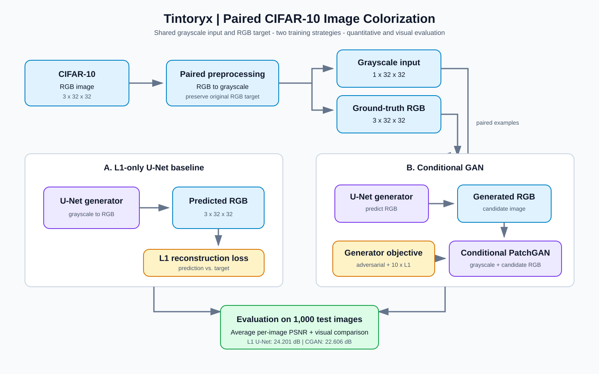

# Tintoryx

### CIFAR-10 Grayscale-to-RGB Colorization with U-Net and Conditional GANs

[](https://github.com/naitik2043/Tintoryx/actions/workflows/ci.yml)


**Tintoryx** is an academic deep-learning project that learns to convert paired 32 x 32 grayscale CIFAR-10 images into RGB images. It compares a U-Net trained with pixel-wise L1 loss against a Conditional Generative Adversarial Network (cGAN) that combines adversarial loss with weighted L1 reconstruction loss.

> **Scope note:** The assignment brief is titled "Historical Photo Restoration", but its specified dataset is CIFAR-10 at 32 x 32 pixels. This repository therefore demonstrates small-image colorization; it is not a validated high-resolution historical-photo restoration system.

## Results at a glance

Both models were trained for 12 epochs on 10,000 CIFAR-10 training images and evaluated on the same 1,000-image test subset.

| Model | Average test PSNR |
| --- | ---: |
| L1-only U-Net baseline | **24.201 dB** |
| Conditional GAN | 22.606 dB |
| CGAN minus baseline | **-1.595 dB** |

The L1-only baseline achieved the higher PSNR, which indicates lower pixel-wise reconstruction error on this test subset. The CGAN produced more vivid colors in some examples, but also showed color differences and artifacts. PSNR measures pixel-level similarity and does not fully describe perceptual quality.

### Visual results

**Paired dataset examples**


**Four-column model comparison**


**Trained CGAN predictions**


**Average test PSNR**


## Architecture



### Models

- **U-Net generator:** maps a 1-channel grayscale image of shape `1 x 32 x 32` to a 3-channel RGB prediction of shape `3 x 32 x 32`.
- **PatchGAN discriminator:** receives the concatenation of a grayscale image and a candidate RGB image (4 channels) and predicts local real/fake logits.
- **Baseline objective:** `L_baseline = L1(prediction, target)`.
- **CGAN generator objective:** `L_G = L_adversarial + 10 x L1`.
- **Discriminator objective:** binary cross-entropy for real grayscale/RGB pairs and generated grayscale/RGB pairs.

## Dataset and preprocessing

Tintoryx uses the CIFAR-10 dataset through `torchvision.datasets.CIFAR10`.

| Split | Samples used |
| --- | ---: |
| Training subset | 10,000 |
| Test subset | 1,000 |
| Image size | 32 x 32 |
| Input | 1-channel grayscale |
| Target | 3-channel RGB |

Each grayscale input is derived from its corresponding RGB image, preserving the paired relationship required for supervised training. The selected train and test subsets are determined using seed 42.

The CIFAR-10 dataset is downloaded locally on first run and is intentionally excluded from Git tracking.

## Training configuration

| Parameter | Value |
| --- | ---: |
| Epochs per model | 12 |
| Batch size | 16 |
| Optimizer | Adam |
| Learning rate | 0.0002 |
| Adam beta 1 | 0.5 |
| CGAN L1 weight | 10 |
| Random seed | 42 |
| Tested GPU | NVIDIA GeForce RTX 2050 |

The reported experiment was run with Python 3.12, PyTorch 2.14.1+cu130, Torchvision 0.29.1+cu130, and CUDA available. Results may vary with hardware, software versions, and training conditions.

## Project structure

```text
Tintoryx/
|-- .github/
|   |-- workflows/
|       |-- ci.yml
|-- docs/
|   |-- architecture.svg
|-- outputs/
|   |-- dataset_pair_preview.png
|   |-- psnr_comparison.png
|   |-- tintoryx_restoration_strip.png
|   |-- tintoryx_trained_predictions.png
|-- src/
|   |-- __init__.py
|   |-- data.py
|   |-- prepare_data.py
|   |-- models.py
|   |-- train.py
|   |-- evaluate.py
|   |-- metrics.py
|   |-- visualize.py
|   |-- infer.py
|-- tests/
|   |-- test_models.py
|-- config.py
|-- requirements.txt
|-- PROJECT_DETAILS.md
|-- README.md
|-- LICENSE
|-- .gitignore
```

The CIFAR-10 data directory and trained model checkpoints are created locally and excluded from Git because they are generated/downloadable artifacts.

## Getting started

### 1. Clone the repository

```bash
git clone https://github.com/naitik2043/Tintoryx.git
cd Tintoryx
```

### 2. Create and activate a virtual environment

**Windows PowerShell**

```powershell
python -m venv .venv
.venv\Scripts\Activate.ps1
python -m pip install --upgrade pip
```

**macOS / Linux**

```bash
python3 -m venv .venv
source .venv/bin/activate
python -m pip install --upgrade pip
```

### 3. Install dependencies

```bash
pip install -r requirements.txt
```

For GPU training, install a PyTorch and Torchvision build compatible with your CUDA driver and platform. The CPU-only workflow used by GitHub Actions is intended for automated tests, not model training.

### 4. Prepare the dataset

```bash
python -m src.prepare_data
```

This downloads/checks CIFAR-10, prints the paired tensor shapes, and saves `outputs/dataset_pair_preview.png`.

### 5. Train the models

Train both models sequentially:

```bash
python -m src.train --model both
```

Or train them separately:

```bash
python -m src.train --model baseline
python -m src.train --model cgan
```

Checkpoints are written to the local `checkpoints/` directory.

### 6. Evaluate and visualize

```bash
python -m src.evaluate
python -m src.visualize
python -m src.infer
```

Evaluation writes `outputs/psnr_comparison.png`. The visualization and inference scripts save their PNGs under `outputs/` without requiring an interactive plot window.

## Run the tests

The unit tests do not download CIFAR-10 or require a GPU:

```bash
python -m unittest discover -s tests -v
```

GitHub Actions runs syntax checks and these CPU model/metric tests on pushes and pull requests to `main`.

## Evaluation metric

Peak Signal-to-Noise Ratio (PSNR) is calculated per image from the mean squared error (MSE), assuming image values are in [0, 1]:

```text
MSE  = mean((prediction - target) ** 2)
PSNR = 10 * log10(1 / MSE)
```

The reported test score is the average of per-image PSNR values across the 1,000-image test subset. Higher PSNR means lower pixel-wise reconstruction error. It does not guarantee that the predicted colors look more realistic to a person.

## Limitations

- CIFAR-10 images are only 32 x 32 pixels and contain small object categories.
- Grayscale-to-color prediction is ambiguous: one grayscale input can have multiple plausible colorizations.
- The experiment uses a 10,000-image training subset and 12 epochs; it is an academic prototype, not a production restoration system.
- PSNR is a pixel-wise metric and should be interpreted alongside visual results.
- The current inference script demonstrates prediction on the CIFAR-10 test subset; arbitrary uploaded-photo inference is not implemented.

## Future work

- Train on larger paired datasets and higher-resolution images.
- Explore perceptual losses and additional image-quality metrics.
- Improve color consistency and reduce adversarial artifacts.
- Add a user-facing interface for uploading grayscale images.
- Record per-epoch training histories for learning-curve analysis.

## Author

**Naitik Gupta**  
Computer Science and Engineering Undergraduate

- GitHub: [@naitik2043](https://github.com/naitik2043)
- Repository: [Tintoryx](https://github.com/naitik2043/Tintoryx)

## License

This project is released under the MIT License. See [LICENSE](LICENSE).
