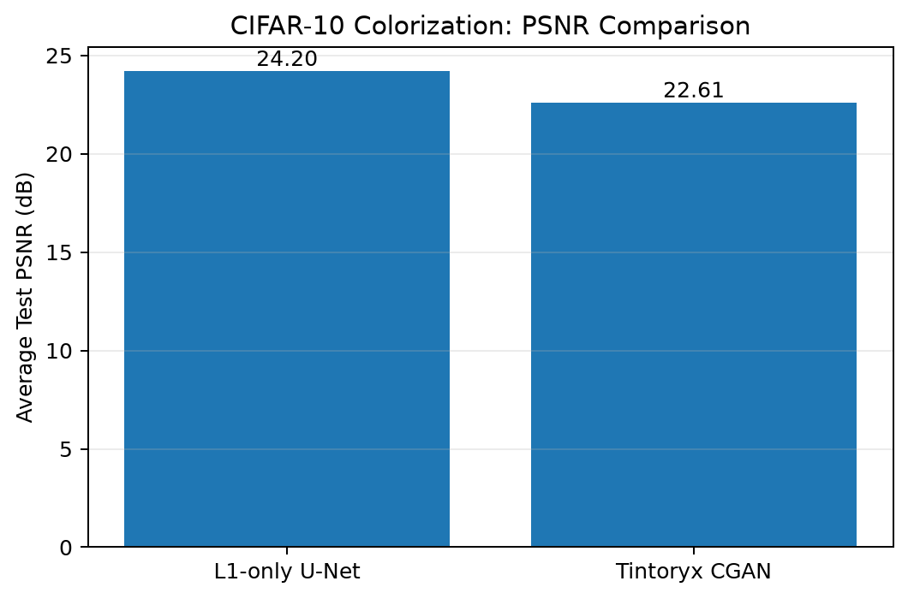

# Tintoryx
### Deep Learning–Based Grayscale-to-Color Image Translation with U-Net and Conditional GANs

<p align="center">
  <strong>A reproducible computer-vision experiment comparing pixel-reconstruction and adversarial learning for paired image colorization.</strong>
</p>

<p align="center">
  <a href="https://github.com/naitik2043/Tintoryx/actions/workflows/ci.yml"></a>
  
  
  
  
</p>

**Tintoryx** is an academic deep-learning project that learns to predict RGB images from paired grayscale inputs. It implements and compares two approaches:

- **U-Net baseline:** trained with pixel-wise L1 reconstruction loss.
- **Conditional Generative Adversarial Network (cGAN):** a U-Net generator trained with adversarial and L1 losses, alongside a conditional PatchGAN discriminator.

The project includes deterministic CIFAR-10 subset preparation, model training, checkpoint saving, evaluation with PSNR and SSIM, visual comparisons, command-line inference, a Streamlit demo, unit tests, and a GitHub Actions CI workflow.

> [!IMPORTANT]
> **Research scope:** The current implementation uses CIFAR-10 images at **32 × 32** resolution. Although the original assignment context refers to historical-photo restoration, this repository demonstrates small-image colorization. It is **not** a validated high-resolution historical-photo restoration or archival-restoration system.

---

## Contents

- [Experiment at a glance](#experiment-at-a-glance)
- [Visual results](#visual-results)
- [How Tintoryx works](#how-tintoryx-works)
- [Model architectures](#model-architectures)
- [Dataset and preprocessing](#dataset-and-preprocessing)
- [Training configuration](#training-configuration)
- [Evaluation methodology](#evaluation-methodology)
- [Repository structure](#repository-structure)
- [Getting started](#getting-started)
- [Run the application](#run-the-application)
- [Run tests](#run-tests)
- [Limitations](#limitations)
- [Potential improvements](#potential-improvements)
- [Documentation](#documentation)
- [Author](#author)
- [License](#license)

---

## Experiment at a glance

| Component | Implementation |
|---|---|
| Task | Paired grayscale-to-RGB image colorization |
| Dataset | CIFAR-10 |
| Training subset | 10,000 images |
| Test subset | 1,000 images |
| Input | 1-channel grayscale image, 32 × 32 |
| Target | 3-channel RGB image, 32 × 32 |
| Baseline | U-Net with L1 loss |
| Adversarial model | U-Net generator + conditional PatchGAN discriminator |
| Generator objective | Adversarial loss + weighted L1 loss |
| Evaluation | PSNR and SSIM |
| Demo | Streamlit |
| Framework | PyTorch |

### Previously recorded PSNR results

The repository documents the following experiment, in which both models were trained for 12 epochs and evaluated on the same 1,000-image test subset.

| Model | Average test PSNR |
|---|---:|
| L1-only U-Net baseline | **24.201 dB** |
| Conditional GAN | 22.606 dB |
| cGAN − baseline | **−1.595 dB** |

**Interpretation:** The L1-only baseline achieved higher PSNR on this test subset, meaning its predictions had lower pixel-wise reconstruction error. The cGAN generated more vivid colors in some examples, but adversarial training did not improve the recorded PSNR in this run. This is a useful experimental result: a more complex model does not automatically perform better on every metric.

The evaluation code also computes SSIM. Run the evaluation command with locally trained checkpoints to generate the current SSIM measurements. No unverified SSIM value is reported here.

---

## Visual results

### 1. Paired dataset examples

Each grayscale input is generated from its corresponding RGB image, providing a paired target for supervised learning.


### 2. Model comparison

The comparison shows the grayscale input, L1 baseline output, cGAN output, and original RGB target.


### 3. Conditional GAN predictions


### 4. Recorded PSNR comparison



---

## How Tintoryx works

The end-to-end workflow is:

```text
           CIFAR-10 RGB images
                    |
                    v
        Convert RGB images to grayscale
                    |
            Paired training data
                    |
             +------+------+
             |             |
             v             v
        Grayscale input  RGB target
             |             |
       +-----+------+      |
       |            |      |
       v            v      |
    U-Net        cGAN      |
   baseline    generator   |
       |            |      |
       |       PatchGAN    |
       |      discriminator
       |            |
       +------+-----+
              |
              v
       Predicted RGB images
              |
              v
      PSNR and SSIM evaluation
              |
              v
      Metrics, plots and samples
```

1. Load CIFAR-10 RGB images.
2. Convert each RGB image into a matching grayscale input.
3. Train a U-Net baseline using L1 loss.
4. Train a conditional GAN using a U-Net generator and PatchGAN discriminator.
5. Evaluate both generators on the same held-out test subset.
6. Compare outputs using PSNR, SSIM, and visual inspection.
7. Save checkpoints and experiment artifacts locally.

---

## Model architectures

### U-Net baseline

The U-Net learns a mapping from a one-channel grayscale tensor to a three-channel RGB prediction.

**Input:** `[batch, 1, 32, 32]`  
**Output:** `[batch, 3, 32, 32]`

Its main components are:

- **Encoder:** progressively reduces spatial dimensions and learns image features.
- **Bottleneck:** processes the compressed feature representation.
- **Decoder:** upsamples features to reconstruct the RGB image.
- **Skip connections:** pass spatial information from encoder layers to decoder layers.
- **Sigmoid output:** keeps predicted pixel values within `[0, 1]`.

The baseline objective is:

```text
L_baseline = L1(predicted RGB, ground-truth RGB)
```

### Conditional Generative Adversarial Network

The cGAN consists of two networks:

**Generator**
- Uses the U-Net architecture.
- Receives a grayscale image.
- Produces a three-channel RGB prediction.

**Conditional PatchGAN discriminator**
- Receives the grayscale image together with a real or generated RGB image.
- Learns to distinguish real grayscale/RGB pairs from generated pairs.
- Produces local patch-level real/fake logits.

The generator objective is:

```text
L_generator = L_adversarial + lambda_L1 × L1(prediction, target)
```

The discriminator uses binary cross-entropy with logits. The L1 term encourages fidelity to the paired target, while the adversarial term encourages locally realistic image patterns.

### Why compare these models?

The U-Net baseline provides a reconstruction-focused reference. The cGAN introduces an adversarial objective that may improve visual realism, but it can also trade exact pixel matching for plausible local patterns. Comparing both models helps show how training objectives affect image-colorization results.

---

## Dataset and preprocessing

Tintoryx uses the CIFAR-10 dataset through `torchvision.datasets.CIFAR10`.

| Setting | Value |
|---|---:|
| Training subset | 10,000 images |
| Test subset | 1,000 images |
| Image resolution | 32 × 32 |
| Input channels | 1 (grayscale) |
| Target channels | 3 (RGB) |
| Subset seed | 42 |

The grayscale input is computed from its corresponding RGB image. This preserves the input-target relationship required for paired supervised learning.

The selected subsets are shuffled deterministically using the configured seed. CIFAR-10 is downloaded locally on first run and is not committed to the repository.

---

## Training configuration

The default settings are defined in `config.py`.

| Hyperparameter | Value |
|---|---:|
| Epochs per model | 12 |
| Batch size | 16 |
| Optimizer | Adam |
| Learning rate | 0.0002 |
| Adam beta 1 | 0.5 |
| cGAN L1 weight | 10 |
| Random seed | 42 |
| Image resolution | 32 × 32 |
| DataLoader workers | 0 |
| Compute device | CUDA when available; otherwise CPU |

The training code records epoch-level losses and saves model checkpoints. Python, NumPy, PyTorch, CUDA, and DataLoader shuffling are seeded for more consistent reruns. Exact reproducibility can still vary with hardware, CUDA versions, and backend operations.

---

## Evaluation methodology

Tintoryx calculates two complementary image-quality metrics.

### Peak Signal-to-Noise Ratio (PSNR)

PSNR measures pixel-level reconstruction error using mean squared error (MSE).

```text
MSE  = mean((prediction - target)²)
PSNR = 10 × log10(1 / MSE)
```

- Higher PSNR indicates lower pixel-wise error.
- The implementation calculates PSNR per image and averages the scores.
- Image values are expected to be in the range `[0, 1]`.

### Structural Similarity Index (SSIM)

SSIM compares local luminance, contrast, and structural information between two images.

- Higher SSIM generally indicates stronger structural similarity.
- Tintoryx uses a Gaussian window and a data range of 1.0.
- SSIM complements PSNR, but neither metric alone fully captures perceived color quality.

### Generate evaluation artifacts

After training both models, execute:

```bash
python -m src.evaluate
```

This generates:

| Output | Description |
|---|---|
| `outputs/evaluation_results.json` | PSNR, SSIM, sample counts, and metric differences |
| `outputs/metrics_comparison.png` | PSNR and SSIM comparison charts |

---

## Repository structure

```text
Tintoryx/
├── .github/
│   └── workflows/
│       └── ci.yml                  # GitHub Actions: syntax checks and tests
├── docs/
│   └── architecture.svg            # Architecture illustration
├── outputs/
│   ├── dataset_pair_preview.png    # Paired grayscale/RGB samples
│   ├── psnr_comparison.png         # Recorded PSNR chart
│   ├── tintoryx_restoration_strip.png
│   └── tintoryx_trained_predictions.png
├── src/
│   ├── __init__.py
│   ├── data.py                     # CIFAR-10 and paired preprocessing
│   ├── prepare_data.py             # Dataset preview generation
│   ├── models.py                   # U-Net and PatchGAN architectures
│   ├── train.py                    # Baseline and cGAN training
│   ├── training_artifacts.py       # Training history and loss plots
│   ├── metrics.py                  # PSNR and SSIM implementations
│   ├── evaluate.py                 # Test-set evaluation and metric charts
│   ├── visualize.py                # Side-by-side prediction visualization
│   └── infer.py                    # Command-line image inference
├── tests/
│   └── test_models.py              # Architecture and metric tests
├── app.py                          # Streamlit user interface
├── config.py                       # Experiment configuration
├── requirements.txt                # Python dependencies
├── PROJECT_DETAILS.md              # Detailed project and viva notes
├── README.md
├── LICENSE
└── .gitignore
```

**Generated locally:** The CIFAR-10 download, trained checkpoints, and generated training/evaluation artifacts are excluded from version control. Run the relevant commands to recreate them.

---

## Getting started

### Prerequisites

- Python 3.10 or newer (the CI workflow uses Python 3.12).
- pip.
- Internet access for the initial CIFAR-10 download.
- A CUDA-compatible PyTorch environment is recommended for faster training, but CPU execution is supported.

### 1. Clone the repository

```bash
git clone https://github.com/naitik2043/Tintoryx.git
cd Tintoryx
```

### 2. Create and activate a virtual environment

**Windows PowerShell**

```powershell
python -m venv .venv
.venv\Scripts\Activate.ps1
python -m pip install --upgrade pip
```

**macOS / Linux**

```bash
python3 -m venv .venv
source .venv/bin/activate
python -m pip install --upgrade pip
```

### 3. Install dependencies

```bash
pip install -r requirements.txt
```

For GPU training, install a PyTorch and Torchvision build compatible with your system and CUDA driver. The GitHub Actions workflow runs CPU tests; it does not train the models.

### 4. Prepare the dataset

```bash
python -m src.prepare_data
```

This downloads or checks CIFAR-10, prints the paired tensor dimensions, and saves a dataset preview to `outputs/dataset_pair_preview.png`.

### 5. Train the models

Train both models:

```bash
python -m src.train --model both
```

Or train them individually:

```bash
python -m src.train --model baseline
python -m src.train --model cgan
```

Checkpoints are saved under `checkpoints/`. Training history and its plot are saved under `outputs/`.

### 6. Evaluate the trained models

```bash
python -m src.evaluate
```

Both model checkpoints must exist before evaluation.

### 7. Generate visual comparisons

```bash
python -m src.visualize
```

The script saves a comparison of grayscale inputs, baseline predictions, cGAN predictions, and ground-truth RGB images.

---

## Run the application

First train the cGAN so that its generator checkpoint is available:

```bash
python -m src.train --model cgan
```

### Streamlit interface

```bash
streamlit run app.py
```

The interface allows users to upload an image, preview the grayscale input and generated RGB output, and download the result.

### Command-line inference

```bash
python -m src.infer --input path/to/grayscale_image.jpg --output outputs/colorized_image.png
```

An optional checkpoint path can also be supplied:

```bash
python -m src.infer --input input.jpg --output output.png --checkpoint checkpoints/tintoryx_cgan_generator.pt
```

> [!NOTE]
> The trained model operates at **32 × 32** resolution. For arbitrary-image inference, the input is resized to 32 × 32 and the prediction is resized back to the original dimensions for display. This resizing does not reconstruct missing high-resolution details.

---

## Run tests

Run the unit tests from the repository root:

```bash
python -m unittest discover -s tests -v
```

The test suite covers:

- U-Net input/output shapes and output range.
- PatchGAN patch-level logits.
- PSNR behavior for identical and distorted predictions.
- SSIM behavior for identical and distorted predictions.
- Metric input-shape validation.

### Continuous integration

The GitHub Actions workflow at `.github/workflows/ci.yml` runs on pushes and pull requests targeting `main`. It installs dependencies, compiles the Python modules, and runs the CPU unit tests.

---

## Limitations

- CIFAR-10 images are only 32 × 32 pixels and contain a limited range of object categories.
- Grayscale-to-color prediction is inherently ambiguous; multiple plausible RGB images can correspond to similar grayscale information.
- The experiment uses a subset of CIFAR-10 and a limited training duration.
- PSNR and SSIM measure different aspects of similarity, but neither fully represents human-perceived color realism.
- Arbitrary-image inference downsamples images to 32 × 32 before prediction.
- The project has not been validated for archival restoration, face restoration, or production deployment.

## Potential improvements

- Train on larger paired datasets and higher-resolution images.
- Add perceptual, feature-based, and color-consistency losses.
- Introduce validation-based checkpoint selection.
- Compare multiple random seeds and report mean and standard deviation.
- Evaluate additional perceptual metrics and conduct human-quality assessments.
- Build a dedicated high-resolution architecture before targeting historical-photo restoration.

---

## Documentation

For the expanded implementation specification, experiment notes, metric explanations, and viva preparation, see **[PROJECT_DETAILS.md](PROJECT_DETAILS.md)**.

The architecture illustration is available at **[docs/architecture.svg](docs/architecture.svg)**.

## Author

**Naitik Gupta**  
Computer Science and Engineering Undergraduate

- GitHub: [@naitik2043](https://github.com/naitik2043)
- Project repository: [Tintoryx](https://github.com/naitik2043/Tintoryx)

## License

Distributed under the MIT License. See [LICENSE](LICENSE) for details.
