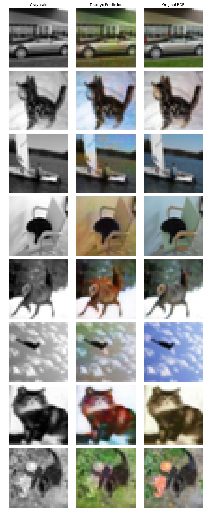

# Tintoryx
### Paired Conditional GAN for CIFAR-10 Image Colorization

**Tintoryx** is a compact deep-learning project that learns to convert 32×32 grayscale CIFAR-10 images into RGB images. It compares a U-Net trained only with pixel-wise L1 loss against a conditional GAN whose generator uses adversarial loss plus weighted L1 reconstruction loss.

> Scope follows the MSE2-DLT-050 brief: 10,000 training images, 1,000 test images, grayscale input, 32×32 RGB target, 12 epochs, a four-column visual comparison, and average test PSNR.

## 1. Problem statement
Colorizing a grayscale image is an ill-posed problem: one gray value can correspond to many possible colors. A regression model trained with L1 loss often predicts average colors and may look dull. A conditional GAN adds a discriminator that encourages generated colors and local image patterns to look more realistic while the L1 term keeps the output connected to the correct paired target.

## 2. Models
- **Baseline:** U-Net generator trained with `L1(predicted_RGB, target_RGB)`.
- **Tintoryx CGAN:** same U-Net generator plus a PatchGAN discriminator. The discriminator receives the concatenation of grayscale input (1 channel) and either real or generated RGB (3 channels).
- **Generator objective:** `L_G = L_adversarial + 10 × L1`.
- **Discriminator objective:** binary cross-entropy on real pairs (label 1) and generated pairs (label 0).

## 3. Pipeline
```text
CIFAR-10 RGB image (3×32×32)
          |
          +-------------------------------> Ground-truth RGB target
          |
     RGB-to-grayscale
          |
   Grayscale input (1×32×32)
          |
     U-Net Generator
          |
   Predicted RGB (3×32×32)
          |
   +------+----------------+
   |                       |
L1-only baseline       Conditional GAN
   |                 + PatchGAN Discriminator
   |                       |
L1 loss              Adversarial + 10 × L1
   |                       |
   +-----------+-----------+
               |
        Test PSNR + visual strip
```

## 4. Project structure
```text
Tintoryx/
├── config.py
├── requirements.txt
├── src/
│   ├── data.py
│   ├── models.py
│   ├── train.py
│   ├── evaluate.py
│   ├── metrics.py
│   └── visualize.py
├── data/             # downloaded automatically by torchvision
├── checkpoints/      # trained model weights
└── outputs/          # comparison image
```

## 5. Setup (Windows PowerShell)
```powershell
python -m venv .venv
.venv\Scripts\activate
python -m pip install --upgrade pip
pip install -r requirements.txt
```

## 6. Run
Run these commands from the project root:
```powershell
# Train both models for 12 epochs each
python -m src.train --model both

# Evaluate both models on the same 1,000-image test subset
python -m src.evaluate

# Generate the four-column visual comparison
python -m src.visualize
```
The first run downloads CIFAR-10 automatically. The evaluation script also saves `outputs/psnr_comparison.png`. Training time depends on hardware. A CUDA-enabled GPU is recommended; CPU training may take substantially longer.

## 7. Evaluation
**PSNR (Peak Signal-to-Noise Ratio)** measures pixel-level reconstruction quality. With images scaled to [0,1]:
`MSE = mean((prediction - target)^2)`
`PSNR = 10 × log10(1 / MSE)`
Higher PSNR indicates lower pixel-wise error. PSNR does not fully measure whether colors look perceptually realistic, so include the four-column visual comparison in the viva.

## 8. Important experimental notes
- Both models use the same train/test subsets, preprocessing, generator architecture, and epoch count for a fair comparison.
- The grayscale input is created deterministically from each original RGB image; each input remains paired with its own RGB target.
- The brief specifies a 12-epoch run. Results can vary with random seed, hardware, and library version. Report the values produced by your actual run; do not invent scores.
- CIFAR-10 contains small object images, not historical photographs. The project title in the brief says “Historical Photo Restoration,” but this implementation demonstrates paired colorization on CIFAR-10 at 32×32 resolution. It should not be presented as a high-resolution archival-photo restoration system.

## 9. Viva talking points
1. Why paired data? Each grayscale input has its exact RGB target, enabling supervised reconstruction.
2. Why U-Net? Encoder-decoder structure learns features while skip connections preserve spatial details.
3. Why a discriminator? It pushes the generator toward realistic-looking local color and texture patterns.
4. Why L1? It penalizes absolute pixel differences and anchors generated colors to the paired target.
5. Why combine adversarial and L1 losses? Adversarial loss encourages realism; L1 encourages fidelity.
6. Why PSNR plus images? PSNR gives a numeric pixel-error measure; visual inspection reveals color quality and artifacts.

## 10. Limitations and future work
- CIFAR-10 resolution is only 32×32.
- The grayscale-to-color mapping is ambiguous; plausible colors may differ from the dataset's original colors.
- A small subset and 12 epochs are suitable for a compact academic experiment, not production-quality restoration.
- Future extensions: larger paired datasets, higher-resolution U-Net, perceptual loss, stronger discriminator, and user-uploaded image inference.

## Trained Model Predictions


