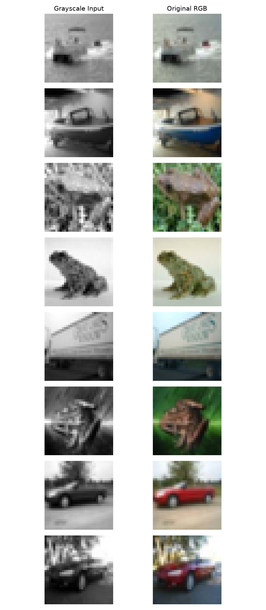
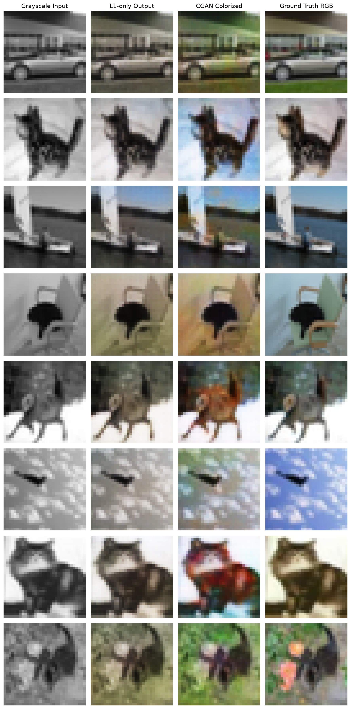

# Tintoryx

### CIFAR-10 Grayscale-to-RGB Colorization with U-Net and Conditional GANs

[](https://github.com/naitik2043/Tintoryx/actions/workflows/ci.yml)


**Tintoryx** is an academic deep-learning project that converts grayscale images into RGB predictions. It compares a U-Net trained with pixel-wise L1 loss against a Conditional Generative Adversarial Network (cGAN), which combines adversarial learning with L1 reconstruction loss.

The repository includes deterministic dataset preparation, model training, checkpointing, PSNR and SSIM evaluation, training-history plots, image comparisons, command-line inference, and a small Streamlit interface.

> **Scope and research note:** The assignment brief refers to historical-photo restoration, but the implemented experiment uses CIFAR-10 images at 32 × 32 resolution. Tintoryx is therefore a small-image colorization prototype. It has not been validated as a high-resolution historical-photo restoration system.

---

## Results at a glance

The documented experiment trained both models for 12 epochs using 10,000 CIFAR-10 training images and evaluated them on the same 1,000-image test subset.

| Model | Average test PSNR |
| --- | ---: |
| L1-only U-Net baseline | **24.201 dB** |
| Conditional GAN | 22.606 dB |
| CGAN minus baseline | **-1.595 dB** |

The L1-only baseline achieved the higher PSNR, indicating lower pixel-wise reconstruction error on this test subset. The cGAN produced more vivid colors in some examples, but also showed color differences and artifacts.

**Metric update:** the evaluation pipeline now calculates both PSNR and SSIM and writes the measured values to `outputs/evaluation_results.json`. The SSIM values must be generated by running the updated evaluation script with locally trained checkpoints; no new SSIM result is claimed in this README.

### Existing visual examples

**Paired CIFAR-10 dataset examples**



**Four-column model comparison**



**Trained cGAN predictions**


**Previously recorded PSNR comparison**


---

## How the system works

1. Load RGB images from CIFAR-10.
2. Convert each RGB image into a corresponding grayscale input.
3. Train a U-Net baseline using L1 reconstruction loss.
4. Train a conditional GAN with a U-Net generator and PatchGAN discriminator.
5. Evaluate both generators on the same held-out test subset.
6. Compare image quality using PSNR and SSIM.
7. Save training history, metric results, visual comparisons, and inference outputs.

### High-level pipeline

```text
        CIFAR-10 RGB image
                |
                v
        Grayscale conversion
                |
         +------+------+
         |             |
         v             v
   Grayscale input   RGB target
         |             |
         v             |
     U-Net / cGAN      |
         |             |
         v             |
   Predicted RGB       |
         |             |
         +------+------+
                |
                v
       PSNR and SSIM metrics
                |
                v
       Results and visualizations
```

## Model architectures

### 1. U-Net generator

The U-Net maps a one-channel grayscale image of shape `1 × 32 × 32` to a three-channel RGB prediction of shape `3 × 32 × 32`.

Its main components are:

- **Encoder:** reduces spatial resolution and learns image features.
- **Bottleneck:** processes compressed feature representations.
- **Decoder:** reconstructs the image and predicts RGB values.
- **Skip connections:** transfer spatial information from encoder layers to corresponding decoder layers.
- **Sigmoid output:** constrains predicted pixel values to the range [0, 1].

The baseline is trained with L1 loss:

```text
L_baseline = L1(prediction, target)
```

### 2. Conditional GAN

The cGAN has two networks:

- **Generator:** uses the U-Net architecture to predict an RGB image from a grayscale input.
- **Discriminator:** uses a conditional PatchGAN to distinguish real grayscale/RGB pairs from generated grayscale/RGB pairs.

The generator objective is:

```text
L_G = L_adversarial + lambda_L1 × L1(prediction, target)
```

The discriminator is trained with binary cross-entropy on real and generated pairs. The PatchGAN produces local real/fake logits rather than one decision for the whole image.

### Why compare both approaches?

The baseline provides a reconstruction-focused reference. The cGAN adds an adversarial objective intended to encourage realistic local color and texture patterns. The experiment tests whether this additional objective improves the results rather than assuming that a more complex model must perform better.

---

## Dataset and preprocessing

Tintoryx uses CIFAR-10 through `torchvision.datasets.CIFAR10`.

| Setting | Value |
| --- | ---: |
| Training subset | 10,000 images |
| Test subset | 1,000 images |
| Image dimensions | 32 × 32 |
| Grayscale input channels | 1 |
| RGB target channels | 3 |
| Subset random seed | 42 |

Each grayscale input is created from its corresponding RGB image, so the input and target remain paired. The training and test subsets are selected deterministically using seed 42.

The dataset is downloaded locally on first run and is excluded from Git tracking.

## Training configuration

| Parameter | Value |
| --- | ---: |
| Epochs per model | 12 |
| Batch size | 16 |
| Optimizer | Adam |
| Learning rate | 0.0002 |
| Adam beta 1 | 0.5 |
| cGAN L1 weight | 10 |
| Random seed | 42 |
| Image size | 32 × 32 |

The training script records per-epoch baseline L1 loss and cGAN generator/discriminator losses. It saves the history as JSON and creates a training-loss plot.

For more consistent reruns, Python, NumPy, PyTorch, CUDA, and DataLoader shuffling are seeded. Exact reproducibility can still vary across hardware, CUDA versions, and backend kernels.

---

## Evaluation metrics

### Peak Signal-to-Noise Ratio (PSNR)

PSNR measures pixel-level reconstruction error through mean squared error (MSE):

```text
MSE  = mean((prediction - target) ** 2)
PSNR = 10 × log10(1 / MSE)
```

Higher PSNR means lower pixel-wise reconstruction error. The implementation averages per-image PSNR values over the test subset.

### Structural Similarity Index (SSIM)

SSIM compares local luminance, contrast, and structure between the predicted image and the target. The implementation uses a Gaussian window and assumes image values in [0, 1].

Higher SSIM generally indicates stronger structural similarity. SSIM complements PSNR; neither metric alone fully describes perceptual color quality.

### Generated evaluation artifacts

After training both models, run:

```bash
python -m src.evaluate
```

The script writes:

- `outputs/evaluation_results.json` — PSNR, SSIM, sample counts, and metric differences.
- `outputs/metrics_comparison.png` — side-by-side PSNR and SSIM comparison charts.

---

## Project structure

```text
Tintoryx/
|-- .github/
|   |-- workflows/
|       |-- ci.yml
|-- docs/
|   |-- architecture.svg
|-- outputs/
|   |-- dataset_pair_preview.png
|   |-- psnr_comparison.png
|   |-- tintoryx_restoration_strip.png
|   |-- tintoryx_trained_predictions.png
|-- src/
|   |-- __init__.py
|   |-- data.py
|   |-- prepare_data.py
|   |-- models.py
|   |-- train.py
|   |-- training_artifacts.py
|   |-- metrics.py
|   |-- evaluate.py
|   |-- visualize.py
|   |-- infer.py
|-- tests/
|   |-- test_models.py
|-- app.py
|-- config.py
|-- requirements.txt
|-- PROJECT_DETAILS.md
|-- README.md
|-- LICENSE
|-- .gitignore
```

The CIFAR-10 dataset and trained model checkpoints are generated locally and intentionally excluded from Git because they are large generated artifacts.

---

## Getting started

### 1. Clone the repository

```bash
git clone https://github.com/naitik2043/Tintoryx.git
cd Tintoryx
```

### 2. Create a virtual environment

**Windows PowerShell**

```powershell
python -m venv .venv
.venv\Scripts\Activate.ps1
python -m pip install --upgrade pip
```

**macOS / Linux**

```bash
python3 -m venv .venv
source .venv/bin/activate
python -m pip install --upgrade pip
```

### 3. Install dependencies

```bash
pip install -r requirements.txt
```

For GPU training, install a PyTorch and Torchvision build compatible with your CUDA driver and platform. The GitHub Actions workflow runs CPU-based tests; it does not train the models.

### 4. Prepare the dataset

```bash
python -m src.prepare_data
```

This downloads/checks CIFAR-10, prints paired tensor shapes, and saves `outputs/dataset_pair_preview.png`.

### 5. Train the models

Train both models:

```bash
python -m src.train --model both
```

Or train one model:

```bash
python -m src.train --model baseline
python -m src.train --model cgan
```

Model checkpoints are written to the local `checkpoints/` directory. Training history is written to `outputs/training_history.json` and `outputs/training_history.png`.

### 6. Evaluate and visualize

```bash
python -m src.evaluate
python -m src.visualize
```

Evaluation requires both model checkpoints. The visualization script saves a four-column comparison of grayscale input, baseline output, cGAN output, and ground-truth RGB.

### 7. Colorize an uploaded image from the command line

```bash
python -m src.infer --input path/to/grayscale_image.jpg --output outputs/colorized_image.png
```

The current model accepts an arbitrary input file but downsamples it to 32 × 32 before prediction. The generated RGB result is resized to the input dimensions for convenient viewing; this resizing does not recover missing high-resolution detail.

### 8. Launch the Streamlit interface

First train the cGAN so that its checkpoint exists, then run:

```bash
streamlit run app.py
```

Upload an image in the browser, preview the grayscale input and generated RGB output, and download the result.

---

## Run the tests

The unit tests do not download CIFAR-10 or require a GPU:

```bash
python -m unittest discover -s tests -v
```

The tests cover:

- U-Net input/output shapes and output range.
- PatchGAN patch-level logits.
- PSNR behavior for perfect and distorted predictions.
- SSIM behavior for identical and distorted images.
- Metric input-shape validation.

GitHub Actions runs Python syntax checks and the CPU unit tests on pushes and pull requests to `main`.

---

## Limitations

- CIFAR-10 images are only 32 × 32 pixels and depict small object categories.
- Grayscale-to-color prediction is ambiguous; one grayscale image can have multiple plausible colorizations.
- The experiment uses a 10,000-image training subset and 12 epochs, so it is an academic prototype.
- PSNR and SSIM measure different aspects of similarity but do not fully capture human-perceived realism.
- The Streamlit and command-line interfaces resize uploaded images to 32 × 32 for inference. Resizing the output back to the original dimensions does not create genuine high-resolution detail.
- The project is not validated for archival restoration, face restoration, or production use.

## Future work

- Train on larger paired datasets and higher-resolution images.
- Evaluate perceptual quality with additional metrics and human review.
- Explore perceptual, color-consistency, and feature-based losses.
- Add per-epoch validation and checkpoint selection.
- Improve inference with a model specifically trained for higher-resolution images.
- Compare multiple random seeds and report variability.

## Author

**Naitik Gupta**  
Computer Science and Engineering Undergraduate

- GitHub: [@naitik2043](https://github.com/naitik2043)
- Repository: [Tintoryx](https://github.com/naitik2043/Tintoryx)

## License

This project is released under the MIT License. See [LICENSE](LICENSE).
